::: {custom-style="Portada Institucion"}
UNIVERSIDAD CONTINENTAL

Escuela de Posgrado

Maestría en Ciencia de Datos
:::

::: {custom-style="Portada Curso"}
Gestión de datos y bases de datos con SQL (PSMA00611)
:::

::: {custom-style="Portada Titulo"}
Base de datos para una aerolínea comercial en Estados Unidos
:::

::: {custom-style="Portada Curso"}
Avance del Producto Académico Colaborativo
:::

::: {custom-style="Portada Datos"}
Integrantes:

Carlos Veliz de Villa Aguirre

Elias Sifuentes Valles

Carlos De los Ríos De la Roca (líder del equipo)

Docentes: Walter Alejandro Silva Sotillo y Max Leoncio Mucha Morales

Sección / NRC: [POR COMPLETAR]

Repositorio: https://github.com/CARLOSDELOSRIOS/aerolinea-bd-psma00611

Lugar y fecha de entrega: [POR COMPLETAR], 2026
:::

```{=openxml}
<w:p><w:r><w:br w:type="page"/></w:r></w:p>
```

::: {custom-style="Titulo Indice"}
Índice
:::

```{=openxml}
<w:p><w:r><w:fldChar w:fldCharType="begin" w:dirty="true"/></w:r><w:r><w:instrText xml:space="preserve"> TOC \o "1-2" \h \z \u </w:instrText></w:r><w:r><w:fldChar w:fldCharType="separate"/></w:r><w:r><w:t>Actualice el índice: clic derecho y «Actualizar campo».</w:t></w:r><w:r><w:fldChar w:fldCharType="end"/></w:r></w:p>
<w:p><w:r><w:br w:type="page"/></w:r></w:p>
```

::: {custom-style="Titulo Indice"}
Índice de figuras
:::

```{=openxml}
<w:p><w:r><w:fldChar w:fldCharType="begin" w:dirty="true"/></w:r><w:r><w:instrText xml:space="preserve"> TOC \h \z \t "Image Caption,3" </w:instrText></w:r><w:r><w:fldChar w:fldCharType="separate"/></w:r><w:r><w:t>Actualice el índice: clic derecho y «Actualizar campo».</w:t></w:r><w:r><w:fldChar w:fldCharType="end"/></w:r></w:p>
```

::: {custom-style="Titulo Indice"}
Índice de tablas
:::

```{=openxml}
<w:p><w:r><w:fldChar w:fldCharType="begin" w:dirty="true"/></w:r><w:r><w:instrText xml:space="preserve"> TOC \h \z \t "Table Caption,3" </w:instrText></w:r><w:r><w:fldChar w:fldCharType="separate"/></w:r><w:r><w:t>Actualice el índice: clic derecho y «Actualizar campo».</w:t></w:r><w:r><w:fldChar w:fldCharType="end"/></w:r></w:p>
```

# Resumen

Este documento cuenta en qué punto está nuestro Producto Académico Colaborativo: una base de datos en la nube para una aerolínea nueva que empezará a volar en Estados Unidos (Universidad Continental, 2026). Lo escribimos para la evaluación del avance, pero también para ordenar lo que ya hicimos y lo que nos falta antes de la entrega final del 16 de noviembre de 2026.

Para el avance, las guías del curso piden tres cosas: registrarse en GitHub, crear el equipo y el proyecto, y subir los scripts (Universidad Continental, 2023). El repositorio ya existe en <https://github.com/CARLOSDELOSRIOS/aerolinea-bd-psma00611> y contiene los scripts T-SQL, la aplicación en Python, las pruebas, la documentación y los borradores del informe y de la presentación. Nos queda sumar como colaboradores a los otros dos integrantes, para que cada uno suba sus cambios con su propia cuenta.

En contenido vamos bien encaminados. Ya tenemos una primera versión completa de los seis componentes que pide el encargo: requisitos, modelo de datos, creación de tablas, carga de datos, consultas y consultas desde Python. La base tiene 39 tablas de negocio y hace cumplir 42 reglas por sí misma. La probamos en un entorno de desarrollo y superó todas las pruebas: 23 de reglas de negocio, 4 de concurrencia y 23 de la aplicación.

Lo que todavía falta, y lo decimos con claridad, es ejecutar el proyecto en nuestras laptops y desplegarlo en Azure SQL Database, que es el requisito de nube del encargo. El documento termina con nuestro plan para lograrlo, los riesgos que vemos y las preguntas que queremos hacer al docente.

# Qué nos pide el curso

## El encargo en un esquema

El curso evalúa el producto en tres momentos: el avance, la presentación oral y la entrega final, con pesos de 20 %, 40 % y 40 % (Universidad Continental, 2023). Las guías incluyen una rúbrica de cuatro criterios para el producto: información, análisis, conclusiones, y estilo y gramática. La figura 1 resume qué pide cada momento y qué debe contener el producto.

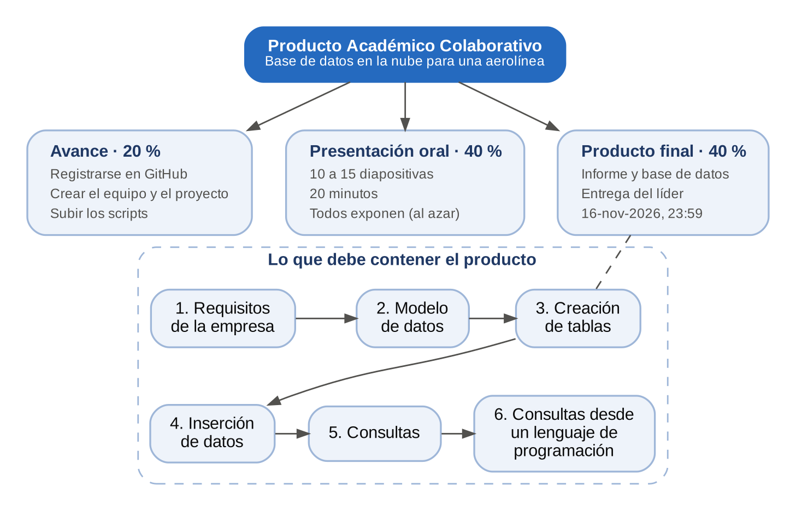{width=88%}

::: {custom-style="Fuente Figura"}
Fuente: guías de aprendizaje y enunciado del aula virtual.
:::

El enunciado del aula virtual no menciona el avance; aparece en el sílabo y en las guías. Tampoco coinciden las fechas: según el documento, el avance va en la semana 2, 3 o 4. No dimos por hecho que la guía de los viernes sea la vigente; preparamos el avance con tiempo para llegar a cualquiera de las tres fechas y lo incluimos entre las preguntas al docente.

## Dónde estamos

La figura 2 muestra el estado de cada componente. El verde indica lo que ya está hecho y probado; el ámbar, lo que avanza; y el rojo, lo que aún no empieza. Cada estado lleva además un símbolo y una palabra, para que se entienda también en blanco y negro.

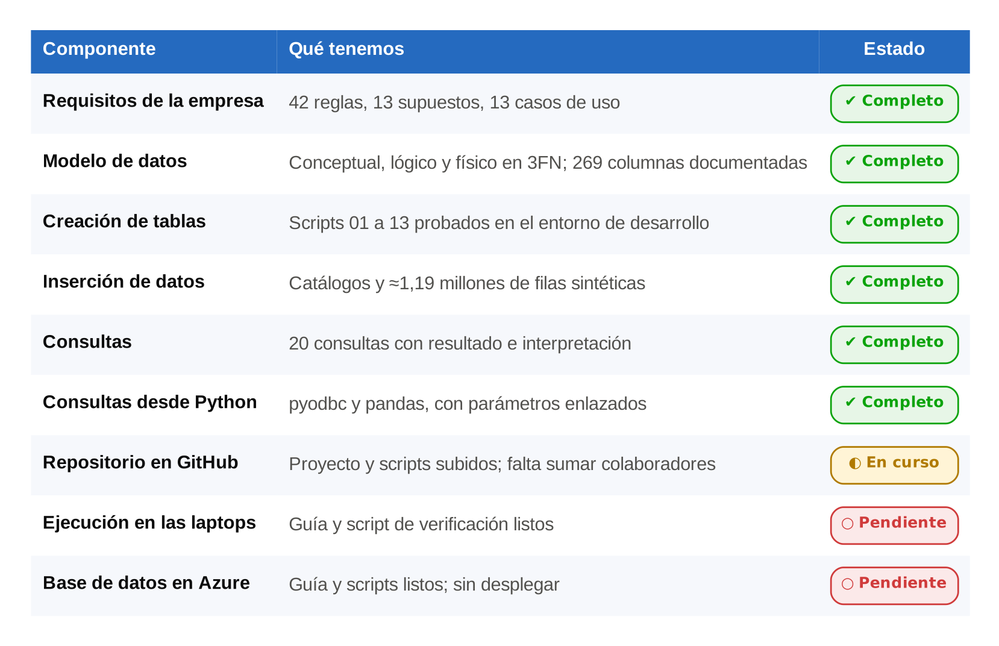{width=92%}

::: {custom-style="Fuente Figura"}
Fuente: repositorio del proyecto y evidencias del entorno de desarrollo.
:::

# Nuestro equipo y cómo trabajamos

## Quiénes somos

Table: Integrantes del equipo

| Integrante | Rol | Participación |
|------------------------|------------------|--------------------------|
| Carlos Veliz de Villa Aguirre | Integrante | Todas las etapas |
| Elias Sifuentes Valles | Integrante | Todas las etapas |
| Carlos De los Ríos De la Roca | Líder: envía el producto en el aula virtual y administra el repositorio | Todas las etapas |

No nos repartimos el trabajo por áreas. Los tres participamos en todas las etapas: decidimos juntos qué pedir en cada momento, redactamos y revisamos juntos los prompts, y revisamos juntos los resultados. Así lo declaramos como equipo.

## Cómo trabajamos

Usamos Claude Code, un asistente de programación de Anthropic, como herramienta de apoyo. El ciclo de trabajo fue siempre el mismo (figura 3): redactamos el prompt, la herramienta genera los archivos y ejecuta las pruebas, revisamos el resultado y lo guardamos en GitHub. Cuando algo no nos convencía, ajustábamos el prompt y repetíamos el ciclo.

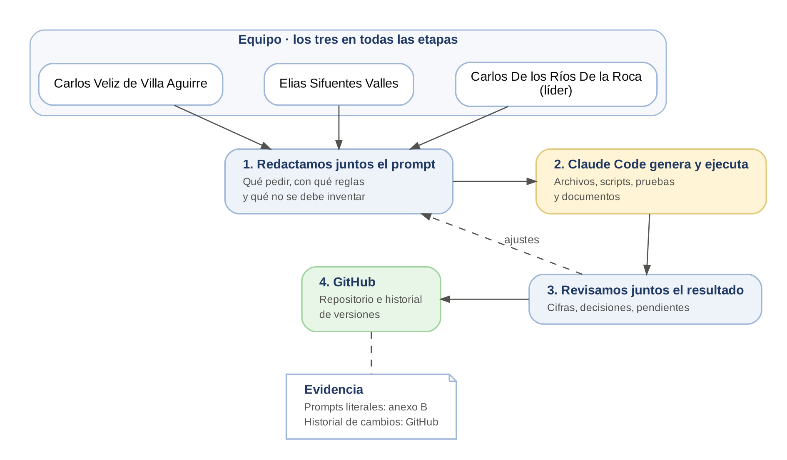{width=88%}

::: {custom-style="Fuente Figura"}
Fuente: declaración del equipo.
:::

En los prompts dejamos reglas claras. Por ejemplo, no inventar integrantes, cifras, referencias ni pruebas; marcar como pendiente lo que no se pudo comprobar; y no afirmar que las pruebas locales cumplen el requisito de nube. Por eso este documento distingue con cuidado lo hecho de lo pendiente. El docente nos pidió adjuntar los prompts: están completos y sin editar en el anexo B.

## Lo que muestra GitHub

El repositorio pertenece a la cuenta de Carlos De los Ríos De la Roca. Los primeros commits aparecen con el autor «Claude», porque los cambios se generaron y se subieron desde la sesión de la herramienta. No representan el aporte de una sola persona, sino el trabajo conjunto descrito arriba. Desde ahora, cada integrante subirá sus cambios con su propia cuenta. Antes de entregar debemos comprobar en *Settings → Collaborators* que Carlos Veliz de Villa Aguirre y Elias Sifuentes Valles figuren como colaboradores.

# El problema y lo que queremos lograr

## El problema

Una aerolínea necesita saber con exactitud qué vuelos ofrece, quién compra y quién viaja, cuánto cobró y cuánto devolvió, y qué avión y qué tripulación opera cada vuelo. Un error en esos datos se nota enseguida: un asiento vendido dos veces, un vuelo con más pasajeros que asientos o un reembolso mal calculado. Además, la información debe servir para decidir —qué rutas se llenan, qué canales venden más—, y para eso todos tienen que calcular las cifras de la misma manera.

## Nuestros objetivos

Nos propusimos un objetivo general y cinco objetivos específicos (figura 4). Cuatro ya tienen una versión completa y probada; el quinto avanza: las pruebas están hechas, pero falta el despliegue en la nube.

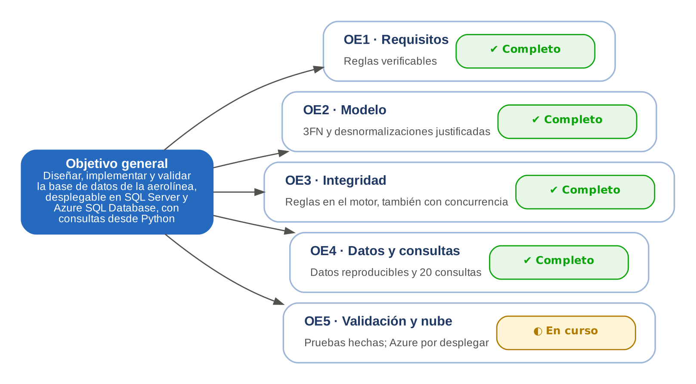{width=85%}

::: {custom-style="Fuente Figura"}
Fuente: elaboración del equipo.
:::

# Cómo entendimos los requisitos

## Las diez relaciones del enunciado

El enunciado enumera diez relaciones que la base debe tener como mínimo y pide «ser exhaustivo con los atributos» (Universidad Continental, 2026). La tabla 2 muestra cómo las implementamos y cuántos atributos tiene cada tabla principal; el diccionario de datos del repositorio describe cada columna con su tipo, dominio y definición.

Table: Relaciones del enunciado y tablas que las implementan

| Relación del enunciado | Tablas | Atributos |
|----------------|-------------------------|-----|
| Clientes | `ven.persona` (toda persona que compra o viaja) y `ven.cliente` (persona con cuenta) | 12 + 8 |
| Empleados | `rh.empleado`, `rh.cargo`, `rh.departamento` | 14 |
| Rutas (origen, destino, día y hora) | `ops.ruta`, `ops.programacion`, `ops.programacion_dia` | 7 + 9 + 2 |
| Vuelos (generados de una ruta programada) | `ops.vuelo`, creado por `ops.usp_generar_vuelos` | 14 |
| Localizaciones (físicas y web) | `ref.localizacion` (aeropuerto, oficina o canal web) y `ref.aeropuerto` | 14 + 7 |
| Tiquetes (clientes registrados o no) | `ven.compra`, `ven.tiquete` | 7 + 20 |
| Aviones (asignados a viajes) | `ops.avion`, `ops.configuracion_asientos` | 9 |
| Cabina (VIP o económica; precio por ruta y cabina) | `ref.cabina`, `ops.vuelo_cabina`, `ven.tarifa` | 7 + 4 + 7 |
| Pagos (uno o más por tiquete) | `ven.pago`, `ven.reembolso` | 12 + 8 |
| Descuentos (porcentaje sobre el precio original) | `ven.descuento` | 11 |

## Pasajero, comprador y cliente no son lo mismo

La primera duda fue quién es «el cliente». El enunciado dice que también compran personas sin registro, y en la práctica quien paga no siempre es quien viaja. Por eso separamos tres ideas (figura 5): toda persona puede comprar o viajar, y solo algunas tienen una cuenta registrada. Así, una compra sin registro no deja campos vacíos ni duplica a nadie.

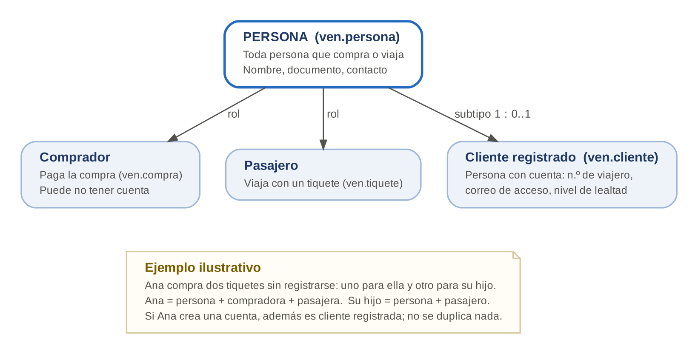{width=82%}

::: {custom-style="Fuente Figura"}
Fuente: modelo de datos del proyecto.
:::

## De la ruta al vuelo con fecha

La segunda duda fue la diferencia entre ruta y vuelo. Lo resolvimos en tres niveles (figura 6): la ruta es solo el par origen-destino; la programación fija el número de vuelo, la hora y los días; y el vuelo es una salida con fecha, que es la que tiene avión, tripulación y estado. El procedimiento `ops.usp_generar_vuelos` crea los vuelos a partir de la programación, tal como pide el enunciado.

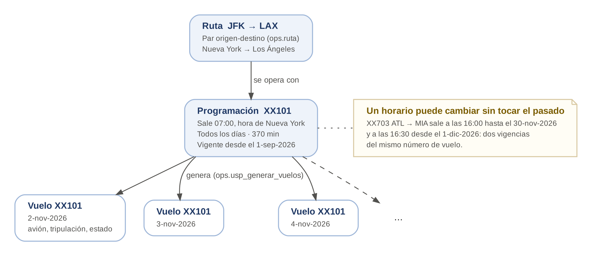{width=88%}

::: {custom-style="Fuente Figura"}
Fuente: sql/09_datos_referencia.sql.
:::

## El precio de un tiquete no cambia después de la venta

Las tarifas cambian con el tiempo, pero un tiquete vendido debe conservar el precio pactado. Por eso el tiquete guarda una copia del precio y del descuento del momento de la venta, y una tarifa ya usada no se edita: se cierra y se crea otra versión. La figura 7 lo muestra con la tarifa real de la ruta JFK-LAX en económica.

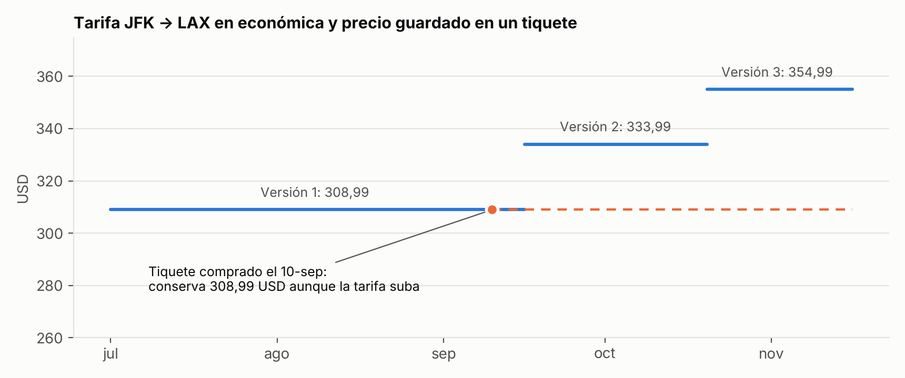{width=86%}

::: {custom-style="Fuente Figura"}
Fuente: sql/09_datos_referencia.sql y consulta Q06.
:::

## Otras decisiones

Table: Otras decisiones que tomamos sobre el enunciado

| Pregunta | Lo que decidimos | Por qué |
|------------------|------------------------|------------------------|
| ¿Se acumulan los descuentos? | Un solo descuento por tiquete: el mayor que corresponda | Evita promociones acumuladas sin control |
| ¿Cómo se paga en partes? | Varios pagos por tiquete; se emite al completar el precio; la reserva vence a las 72 horas | El enunciado permite uno o más pagos por tiquete |
| ¿Qué hora se guarda si la red cruza cinco husos horarios? | La hora local con su desfase en los vuelos y la hora UTC en las transacciones | Evita errores con el horario de verano y las llegadas al día siguiente |
| ¿Cuándo se devuelve el dinero? | Cancelación sin penalidad en las primeras 24 horas si se compró con 7 días o más de anticipación; luego, según la cabina | Sigue la norma del Departamento de Transporte de Estados Unidos (Customer Service Plan, 2026) |

Donde el enunciado no decía nada, lo completamos con supuestos explícitos: son trece (SUP-01 a SUP-13) y están en el análisis de requisitos del repositorio.

# Cómo diseñamos el modelo de datos

## El modelo conceptual

La figura 8 muestra las 19 entidades del modelo y sus relaciones. Todo gira alrededor del tiquete. La pieza que evita la sobreventa es el cupo por vuelo y cabina: cada venta ocupa una plaza de ese cupo, y la base no deja vender si no queda ninguna.

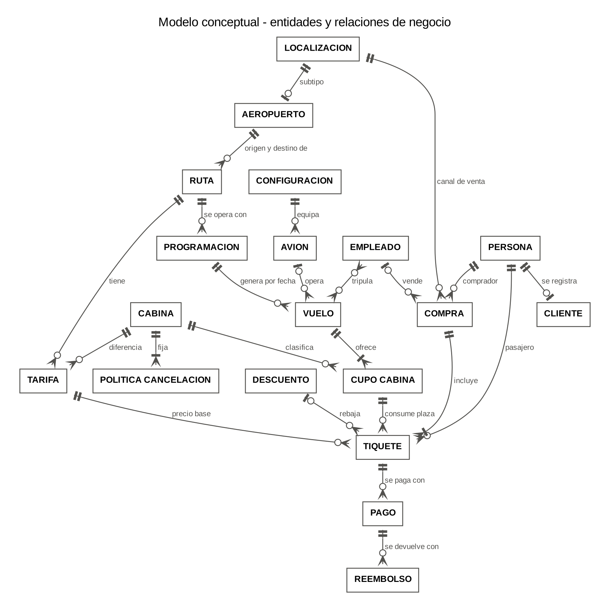{width=80%}

::: {custom-style="Fuente Figura"}
Fuente: docs/02_modelo/diagramas/conceptual.mmd.
:::

A partir de este modelo construimos cuatro diagramas lógicos (red y vuelos; flota y tripulación; personas y tiquetes; precios y pagos) y el modelo físico. Los diagramas físicos y el diccionario se generan directamente desde la base, de modo que no pueden contradecir al código.

## Normalización

Normalizar es repartir los datos en tablas de modo que cada dato se guarde una sola vez y en el lugar correcto (Codd, 1970; Elmasri y Navathe, 2011). Partimos de una planilla de ventas imaginaria con todo junto y la fuimos descomponiendo hasta la tercera forma normal (figura 9).

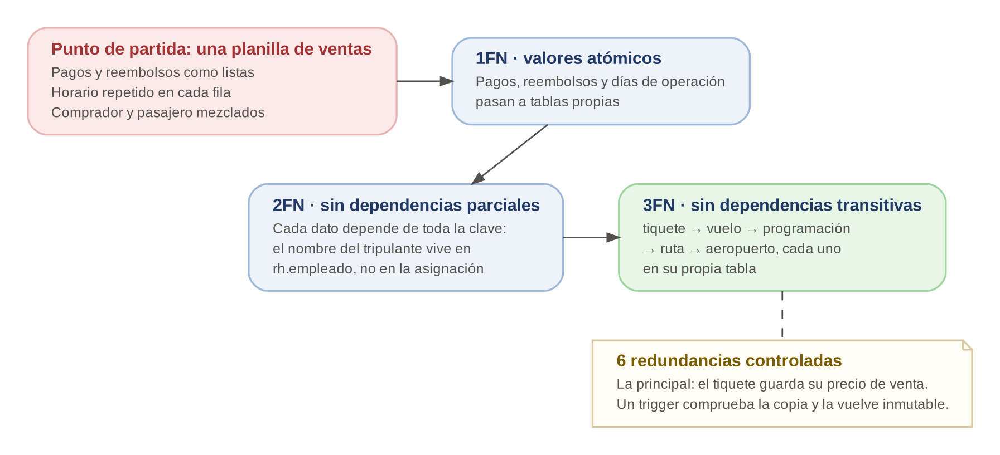{width=82%}

::: {custom-style="Fuente Figura"}
Fuente: docs/02_modelo/normalizacion.md.
:::

Mantuvimos seis redundancias a propósito, cada una con su justificación y su control. La más importante es la copia del precio en el tiquete. No genera inconsistencias porque el precio del tiquete es un hecho de la venta, no la tarifa de hoy: un trigger comprueba que la copia coincida con la tarifa vigente al vender e impide modificarla después.

# Qué hemos construido

## Los scripts y su orden

Organizamos los scripts T-SQL en el orden en que deben ejecutarse (figura 10). Todos se pueden volver a ejecutar sin errores ni duplicados. Lo único que borra la base está aislado en un script marcado como destructivo, que pide confirmación y se niega a funcionar en Azure.

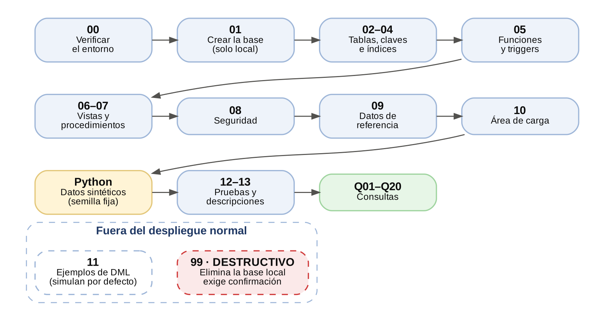{width=86%}

::: {custom-style="Fuente Figura"}
Fuente: sql/README.md.
:::

## Las reglas viven dentro de la base

Queríamos que la base hiciera cumplir sus reglas aunque alguien insertara datos sin pasar por la aplicación, por ejemplo desde SSMS. Para eso las reglas se organizan en capas (figura 11). Primero, restricciones declarativas, que son las más simples y seguras; después, triggers, solo donde una restricción no alcanza, como al validar un cambio de estado o impedir que un avión tenga dos vuelos a la vez; luego, procedimientos almacenados para las operaciones completas; y, al final, consultas de control.

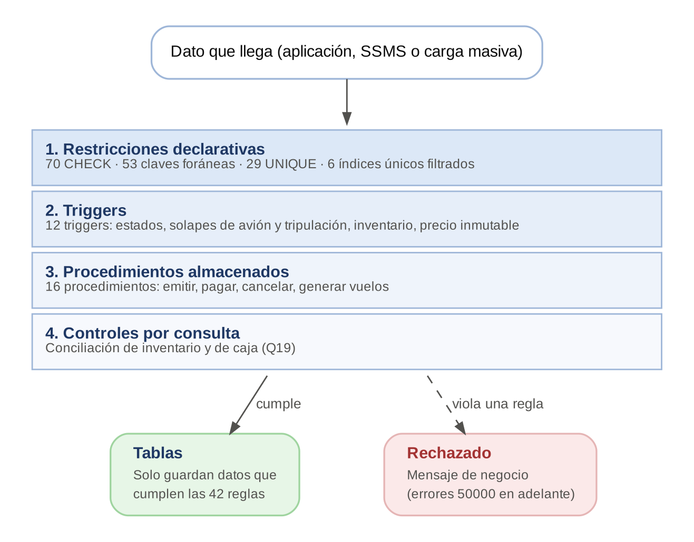{width=72%}

::: {custom-style="Fuente Figura"}
Fuente: catálogo de la base y docs/01_requisitos/analisis_requisitos.md.
:::

## La aplicación en Python

La aplicación de consola automatiza el trabajo repetitivo (figura 12): comprueba la conexión, despliega los scripts, genera y carga los datos sintéticos, ejecuta las pruebas y las consultas, y produce los CSV, los gráficos y los documentos. Las consultas reciben sus valores como parámetros, nunca pegados al texto SQL, para evitar la inyección de código. La configuración se lee de un archivo `.env` que no se sube a GitHub, y en las laptops usamos autenticación de Windows, así que no hay contraseñas guardadas.

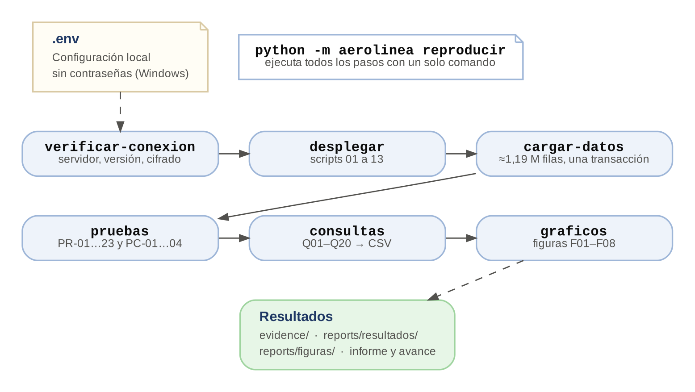{width=86%}

::: {custom-style="Fuente Figura"}
Fuente: src/aerolinea/cli.py.
:::

## Arquitectura local y en la nube

El mismo código T-SQL está pensado para la laptop y para Azure SQL Database (figura 13). Las diferencias entre ambos entornos se resolvieron en el diseño: los scripts de despliegue no usan `USE`, la conexión siempre va cifrada y, en Azure, el certificado del servidor se valida siempre. Para no generar costos proponemos la oferta gratuita de Azure SQL Database, que pausa la base cuando se agota el cómputo mensual incluido (Microsoft, s. f.). **Todavía no hemos creado ningún recurso en Azure**: falta una suscripción y la autorización del equipo.

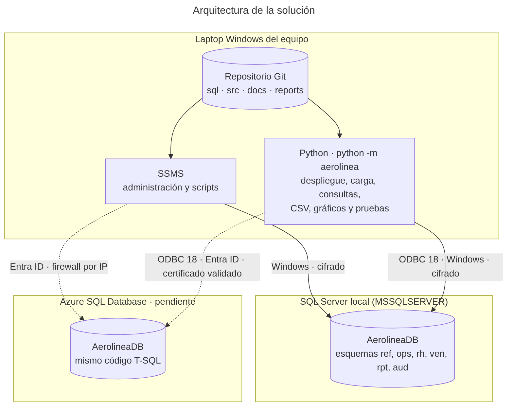{width=70%}

::: {custom-style="Fuente Figura"}
Fuente: docs/03_arquitectura/arquitectura.mmd.
:::

# Qué hemos comprobado

## Las pruebas

Todas las pruebas de este avance se hicieron en un entorno de desarrollo: un contenedor con SQL Server 2022 Developer (versión 16.0.4305.5), el controlador ODBC 18 y Python 3.13. Ese entorno demuestra que el código funciona sobre un motor SQL Server real, **pero no reemplaza** la ejecución en nuestras laptops ni el despliegue en la nube (figura 14). También repetimos las pruebas con el nivel de compatibilidad de SQL Server 2016 y obtuvimos los mismos resultados.

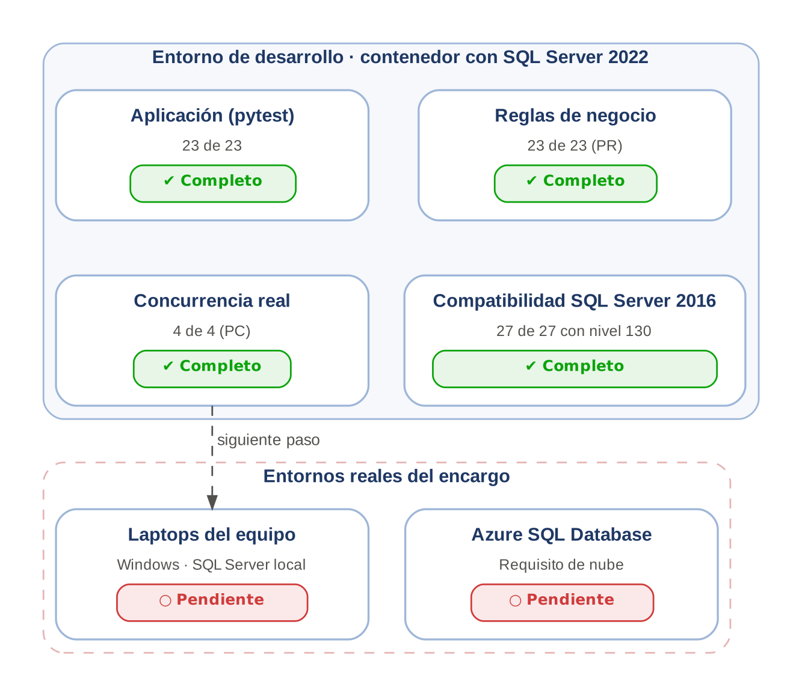{width=72%}

::: {custom-style="Fuente Figura"}
Fuente: evidence/contenedor_linux/resultados_pruebas.json.
:::

## Ventas simultáneas sin sobreventa

La prueba que mejor explica el diseño es la de concurrencia (figura 15). Cuarenta sesiones intentan comprar al mismo tiempo en una cabina VIP de 12 asientos: exactamente 12 lo logran y las otras 28 reciben un mensaje claro de que no hay plazas. Para lograrlo no subimos el aislamiento de toda la base; solo bloqueamos la fila del cupo que se disputa, lo que protege la regla sin frenar al resto del sistema (Berenson et al., 1995).

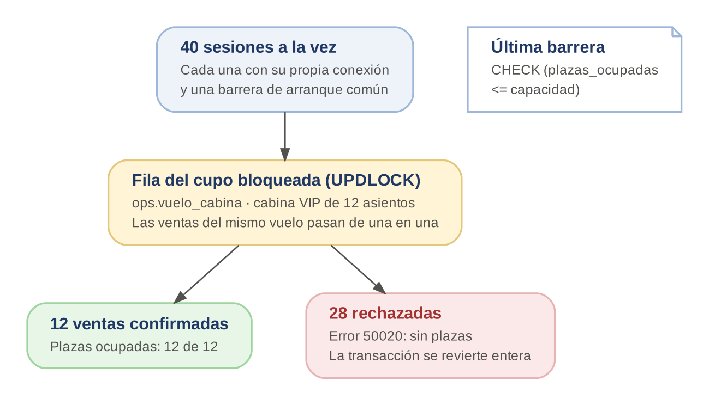{width=70%}

::: {custom-style="Fuente Figura"}
Fuente: prueba PC-01.
:::

## Primeros resultados

Para probar las consultas cargamos datos sintéticos, es decir, inventados con reglas conocidas y una semilla fija (20261106) para que siempre salgan iguales. Las cifras sirven para comprobar que el modelo y las consultas funcionan, no para describir un mercado real.

Table: Indicadores preliminares con datos sintéticos

| Indicador | Valor | Consulta |
|-------------------------|---------------|------|
| Ocupación ponderada (económica · VIP) | 68,9 % · 53,0 % | Q02 |
| Ventas brutas · cobros · reembolsos (julio a octubre de 2026) | 73,52 · 72,27 · 3,03 millones de USD | Q03 |
| Compras hechas por compradores registrados | 41,9 % (el generador usa 42 %) | Q08 |
| Vuelos que llegan con menos de 15 minutos de demora | 78,4 % | Q15 |
| Máximo de horas de vuelo de un piloto en 28 días | 94,5 horas (referencia normativa: 100) | Q18 |

Que la consulta Q08 devuelva 41,9 % cuando el generador usa 42 % es una buena señal: la consulta calcula lo que dice calcular. La figura 16 muestra otro hallazgo útil. Ventas, cobros y reembolsos no son lo mismo y no siempre coinciden en el mismo mes: hay reservas pagadas en partes y devoluciones de ventas anteriores. Por eso cada cifra se calcula por separado y por su propia fecha. Aun así, la caja cuadra al centavo (consulta Q19).

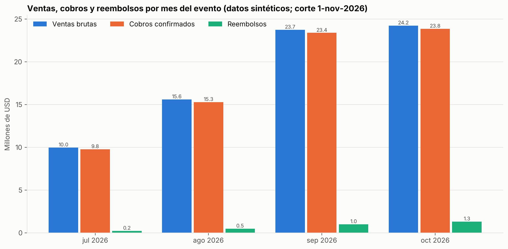{width=88%}

::: {custom-style="Fuente Figura"}
Fuente: reports/figuras/F02_flujo_mensual.png.
:::

## Lo que aprendimos en el camino

Las pruebas encontraron 20 errores reales durante el desarrollo; todos están documentados con su causa y su corrección. Tres nos enseñaron especialmente:

- **Cuando todos piden a la vez.** La primera versión de la asignación automática de asientos solo atendió 6 de 30 pedidos simultáneos, porque todos elegían al mismo tiempo el mismo «primer asiento libre». Lo resolvimos atendiendo los pedidos de un mismo vuelo y cabina de uno en uno.
- **El valor desconocido.** En SQL, una comparación con un valor vacío (`NULL`) no es ni verdadera ni falsa, sino desconocida. Por ese detalle, un empleado sin categoría podía quedar asignado como capitán.
- **Datos inventados, pero creíbles.** Una consulta mostró que, en la primera versión de los datos sintéticos, algunos pilotos superaban el límite normativo de 100 horas de vuelo en 28 días (Cumulative Limitations, 2026). Ajustamos el generador hasta quedar por debajo.

# Lo que sigue

## Plan de trabajo

La figura 17 y la tabla 5 muestran nuestro plan hasta la entrega final. Las fechas son una propuesta del equipo; las que dependen del docente quedan por confirmar.

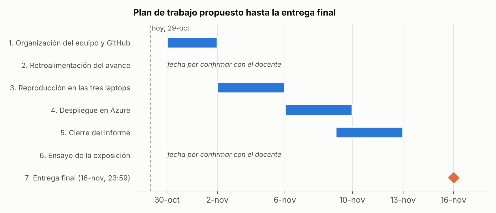{width=88%}

::: {custom-style="Fuente Figura"}
Fuente: elaboración del equipo.
:::

Table: Plan de trabajo propuesto

| Hito | Qué haremos | Fecha objetivo | Responsable |
|----------------|------------------------------|-------------|----------|
| 1. Organización del equipo | Sumar a los tres al repositorio y fijar las reuniones de coordinación | 30 de octubre al 2 de noviembre | Todo el equipo |
| 2. Retroalimentación del avance | Hacer al docente las preguntas de la tabla 6 y aplicar sus indicaciones | Por confirmar | Todo el equipo |
| 3. Reproducción en las laptops | Verificar el entorno, reconstruir la base con un comando y guardar las evidencias | 2 al 6 de noviembre | Cada integrante en su laptop |
| 4. Despliegue en Azure | Obtener la autorización, crear la base con la oferta gratuita, desplegar, cargar y verificar | 6 al 10 de noviembre | Todo el equipo |
| 5. Cierre del informe | Revisar cada sección e incorporar las evidencias de la laptop y de Azure | 9 al 13 de noviembre | Todo el equipo |
| 6. Ensayo de la exposición | Ensayar los 20 minutos y la demostración en vivo; cualquiera puede exponer cualquier parte | Antes de la presentación oral (por confirmar) | Todo el equipo |
| 7. Entrega final | Enviar el producto en el aula virtual | 16 de noviembre, 23:59 | Carlos De los Ríos De la Roca (líder) |

## Riesgos

Identificamos cinco riesgos y, para cada uno, una medida concreta (figura 18). El más importante es no conseguir una suscripción de Azure a tiempo, porque sin ella no se cumple el requisito de nube.

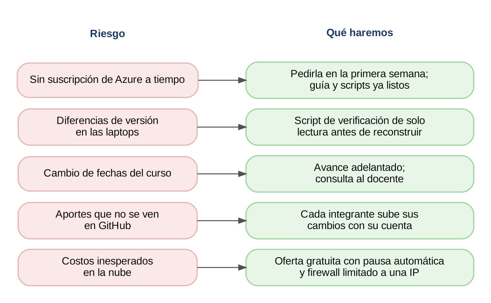{width=75%}

::: {custom-style="Fuente Figura"}
Fuente: elaboración del equipo.
:::

## Preguntas para el docente

Table: Preguntas que queremos hacer en la retroalimentación del avance

| N.º | Pregunta | Por qué la hacemos |
|---|--------------------------------|------------------------------|
| 1 | ¿En qué semana se evalúa el avance? | Los documentos del curso dicen semana 2, 3 o 4 |
| 2 | ¿Cuál es el mínimo de páginas del informe final? | La rúbrica lo menciona, pero ningún documento lo fija; proponemos de 30 a 40 páginas de cuerpo |
| 3 | ¿El «equipo» de GitHub debe ser una organización o basta un repositorio con los tres como colaboradores? | Define cómo organizamos el repositorio |
| 4 | ¿La universidad ofrece una suscripción de Azure para estudiantes? | Condiciona el despliegue en la nube |
| 5 | ¿Es válido un modelo más amplio que las diez relaciones mínimas, con datos sintéticos? | Confirma el alcance que elegimos |

# Conclusiones del avance

Lo más difícil del encargo no fue crear tablas, sino ponernos de acuerdo sobre qué significa cada palabra del enunciado. Separar al pasajero del comprador, el horario del vuelo con fecha y el precio pactado de la tarifa vigente fue lo que permitió un modelo en tercera forma normal y consultas que dan resultados coherentes.

También aprendimos que las reglas deben vivir dentro de la base y no solo en la aplicación. Gracias a eso, la carga de más de un millón de filas funcionó como una prueba más: la base rechazó cada dato incoherente, y así encontramos errores que de otro modo habríamos pasado por alto.

Además, comprobar algo exige decir dónde se comprobó. Las pruebas superadas en el entorno de desarrollo muestran que el código es correcto, pero no reemplazan la ejecución en nuestras laptops ni el despliegue en Azure. Por eso los dejamos como pendientes y los pusimos en el centro del plan.

Por último, el requisito propio del avance —el repositorio con los scripts— está cumplido en lo técnico y en marcha en lo colaborativo. El siguiente paso es que los tres subamos nuestros cambios con nuestras propias cuentas, para que el historial de GitHub refleje el trabajo de todo el equipo.

# Referencias

Berenson, H., Bernstein, P., Gray, J., Melton, J., O'Neil, E., & O'Neil, P. (1995). A critique of ANSI SQL isolation levels. En *Proceedings of the 1995 ACM SIGMOD International Conference on Management of Data* (pp. 1–10). Association for Computing Machinery. https://doi.org/10.1145/223784.223785

Codd, E. F. (1970). A relational model of data for large shared data banks. *Communications of the ACM, 13*(6), 377–387. https://doi.org/10.1145/362384.362685

Cumulative limitations, 14 C.F.R. § 117.23 (2026). https://www.ecfr.gov/current/title-14/chapter-I/subchapter-G/part-117/section-117.23

Customer service plan, 14 C.F.R. § 259.5 (2026). https://www.ecfr.gov/current/title-14/chapter-II/subchapter-A/part-259/section-259.5

Elmasri, R., & Navathe, S. B. (2011). *Fundamentals of database systems* (6th ed.). Addison-Wesley.

Microsoft. (s. f.). *Deploy Azure SQL Database for free*. Microsoft Learn. Recuperado el 27 de octubre de 2026, de https://learn.microsoft.com/en-us/azure/azure-sql/database/free-offer

Universidad Continental. (2023). *Guía de actividades de aprendizaje: Gestión de datos y bases de datos con SQL (PSMA00611)*. Escuela de Posgrado.

Universidad Continental. (2026). *Producto académico colaborativo: Gestión de datos y bases de datos con SQL (PSMA00611)* [Enunciado del aula virtual]. Escuela de Posgrado.

# Anexo A. Árbol de archivos del repositorio

La figura 19 resume las carpetas del repositorio y cuántos archivos tiene cada una. Debajo está el árbol completo. Cuando un mismo archivo existe en varios formatos (por ejemplo, un diagrama en `.mmd`, `.dot`, `.png`, `.svg` y `.pdf`), se muestra una sola vez con sus extensiones entre llaves. Los datos sintéticos en CSV no se suben a GitHub porque se regeneran con la semilla; se conserva su manifiesto con las huellas SHA-256.

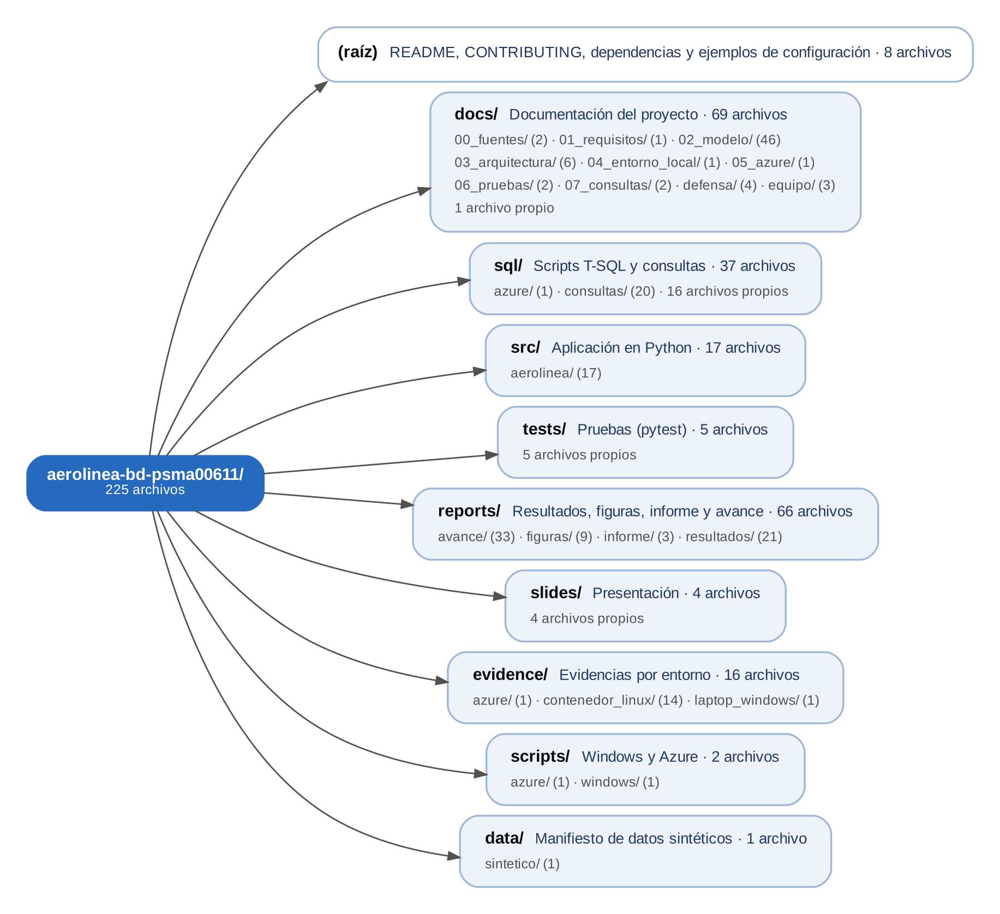{width=80%}

::: {custom-style="Fuente Figura"}
Fuente: lista de archivos del repositorio.
:::

[[BLOQUE:ARBOL]]

# Anexo B. Prompts utilizados

Estos son, sin editar, todos los prompts que enviamos a Claude Code desde el inicio del proyecto hasta la preparación de este documento, en orden cronológico. También incluimos nuestras respuestas a las preguntas que nos hizo la herramienta. Las fechas están en hora UTC. Copiamos los textos del registro de la sesión tal como se escribieron, con sus errores de tipeo. También están guardados en el repositorio, en `docs/equipo/prompts.json`.

Según nuestra declaración como equipo, los tres integrantes redactamos y revisamos juntos cada prompt.

[[BLOQUE:PROMPTS]]

# Anexo C. Declaración sobre el uso de inteligencia artificial

Para desarrollar este producto usamos Claude Code, un asistente de programación de Anthropic, en una sesión remota en la nube. A partir de nuestros prompts (anexo B), la herramienta generó los archivos del proyecto —scripts, código, documentación, informe, presentación y este documento— y ejecutó las pruebas en un entorno de desarrollo.

Los tres integrantes redactamos y revisamos juntos los prompts y revisamos los resultados. Las cifras de este documento provienen de ejecuciones reales guardadas en el repositorio, y los datos analizados son sintéticos. Asumimos la responsabilidad por el contenido y por su defensa oral, conforme a las normas de la universidad y a las indicaciones de los docentes.
